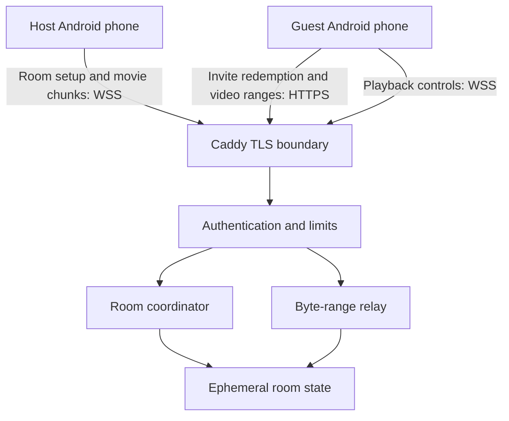
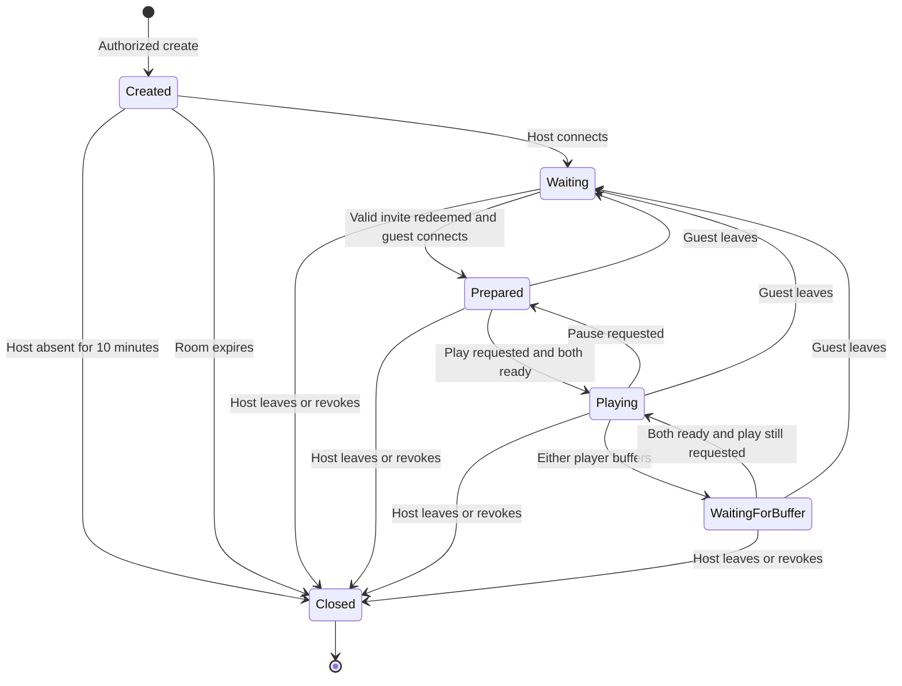

# WatchTogether system design — v0.2

## Scope and quality targets

Two Android phones in different locations watch one seekable file held by the host. A relay bridges networks that do not permit inbound phone connections. Playback remains in the foreground. File bytes are relayed on demand, without storing the entire movie on the server. Targets are bounded memory, private access and approximate synchronization; this build has not established a sustained bitrate or two-hour reliability guarantee.

The host also sends playback controls through the same coordinator. Caddy terminates TLS and forwards to a private loopback/container port. Both Caddy and the relay are trusted with movie contents. There is no CDN or persistent media store in this version.

## Separation of responsibilities

| Component | Responsibility | Data retained |
|---|---|---|
| Android file reader | User-selected URI, validate size, answer bounded offset reads | URI and session credentials in process memory |
| Android player | Decode local file/HTTP stream, report readiness, apply timeline | Temporary playback buffers |
| Android connection client | Create/redeem/connect, refuse redirects, validate HTTPS origin | Server origin preference; no persisted host key or invite |
| `security.py` | Creator authentication, token hashing, request/WS policy, response headers | Bounded request counters; server creator key in process |
| `server.py` coordinator | Roles, invitation redemption, timeline, readiness, expiry/revocation | Room state and credential digests only |
| `server.py` relay | Serve ranges; request 256 KiB source blocks | Pending bounded chunks, no media files written by app code |

## Room lifecycle

All live states also close at the absolute 12-hour room deadline or server shutdown. Server time uses a monotonic clock; clients do not control expiration. The ten-minute invite is consumed once and exchanged for a separate guest session token. The same session token may reconnect while the room is alive, but the Android UI currently discards it on failure. The user must create a new room if redemption succeeds but connection/setup fails. Invite regeneration and seamless reconnect are future work.

## Playback coordination

The authoritative state is `(position_ms, desired_playing, ready_host, ready_guest, updated_monotonic)`. Effective playback requires both sockets connected, both players ready and `desired_playing=true`. Any participant may issue shared controls; only the host may issue periodic position ticks. Ticks every two seconds follow actual host playback. Clients seek if reported drift exceeds one second. Round-trip latency is not estimated, so synchronization is approximate.

When a player buffers, it reports `ready=false`; the server preserves the current timeline and pauses both. When both become ready, the server resumes if play is still desired. Both participants are intentionally equal in play/pause permissions; only the host owns room revocation and source data.

## Video request path

1. Guest ExoPlayer requests an authenticated HTTP byte range.
2. Relay validates room access, offset and stream quota.
3. Relay sends the host `read(id, offset, length)` over WSS.
4. Host reads at most 256 KiB from the selected URI, returning `chunk(id, base64)`.
5. Relay validates exact length and sends the bytes to the guest.
6. Repeat with backpressure until the requested range completes. A request times out after 30 seconds if the host does not answer. Expiry/revocation invalidates subsequent reads and closes pending ones.

Host playback reads the file locally. No total-file upload is required. Offsets and sizes use 64-bit-compatible integers. A source MIME value must match the video MIME pattern. Codec support is a device constraint, independent of file-size support.

## Capacity and failure boundaries

| Property | Current bound or behavior |
|---|---|
| Roles | One host socket and one guest socket, reserved before handshake |
| Movie size | Positive signed 64-bit byte count; no smaller configured file-size limit |
| Room lifetime | 12 hours, not extended by activity |
| Pending media | At most two HTTP stream slots per room; one outstanding block per stream |
| Source block | 256 KiB; base64 increases upstream video bytes by about one third |
| Request body | 4 KiB |
| WebSocket frame | Guest 4 KiB; host 512 KiB (to carry a base64 block) |
| Active rooms | 100 per process |
| Rate counters | At most 4,096 remote-address/category buckets |
| Request limits | Six create attempts/minute; 180 other API requests/minute per socket peer |
| WebSocket limits | 80 text messages/second and 12 controls/second per socket |
| Disconnect | Host closes room; guest departure pauses room |
| Restart | All rooms and credentials disappear |

A 256 KiB block represents about 0.42 seconds of a 5 Mbps video. Sequential request/response latency limits throughput; there is no claim that every connection can sustain that bitrate. Process/library/transport buffers add memory beyond raw block sizes. Verify RSS under load rather than treating block size as the total memory budget.

## Deployment and future scale

Current implementation is one coordinator/relay process behind a TLS proxy. Load balancing across independent processes will break room lookup. Before scaling, introduce authenticated user identities and quotas, a shared room directory with explicit owner affinity, and a separately measured media relay tier. Redis could hold ownership and short-lived control state; source streams still need an explicit routed path to their owning process. These components are design options, not included features.

Before public launch, complete Android builds and device tests, dependency scanning, external security review, edge admission/connection limits, telemetry without credentials, load tests and operating procedures. End-to-end encryption would require a different media transport/player design and key exchange; TLS alone does not provide it.
